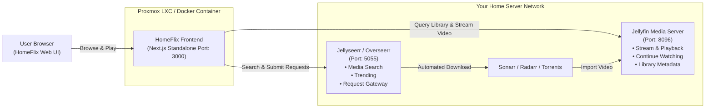

# 🍿 HomeStream (HomeFlix)

> **A modern, responsive web companion and streaming frontend built specifically for your self-hosted media stack.**
> Seamlessly interfaces with **Jellyfin** for local media streaming and **Seerr** (Jellyseerr / Overseerr) for catalog searching and 1-click automated requests. Easily deployed via **Proxmox VE LXC** (as HomeFlix on LXC 111) or Docker.

---

## ⚖️ Disclaimer

**HomeStream** (deployed as **HomeFlix**) is an independent, open-source, non-commercial companion client designed solely to interface with personal, self-hosted media server stacks (such as Jellyfin and Jellyseerr/Overseerr).

This project is **not** affiliated with, endorsed by, sponsored by, or associated in any way with Netflix, Inc. or any commercial streaming service provider. All product names, logos, and brands are property of their respective trademark owners. Use of these names, logos, and brands does not imply endorsement or affiliation.

---

## ✨ Features

- **🎬 Modern Cinematic Streaming Experience**:
  - Dark cinematic aesthetic (`#141414`), sleek red accents, and smooth typography.
  - Dynamic **Hero Billboard** featuring featured backdrop, match rating, tags (4K, 5.1, TV-MA), synopsis, "Play" and "More Info" buttons.
  - Multi-item dynamic billboard that auto-rotates through featured items with manual carousel controls.
  - Horizontal scrolling carousels with smooth navigation and card hover zoom previews.
  - Hover previews seek automatically to random points (15%–75% runtime) with teaser loop and audio toggle.
  - **Top 10 Today** row with massive stylized rank numerals (1–10).
  - **Continue Watching** row with user resume progress bars and direct resume click.
  - Category and genre rows (Recently Added Movies, Recently Added Series, Trending) strictly partitioned by media type.

- **📺 Dual-Mode Web Video Player & Native Jellyfin Embed**:
  - Fullscreen video playback with custom scrubber timeline, buffer bar, 10-second skip forward/back, and volume control.
  - Streams directly from Jellyfin (`/Videos/{itemId}/stream`) or embeds Jellyfin's native web player in 1-click.
  - Episode drawer for TV shows to jump between episodes or auto-play next episode.
  - Reports playback progress to Jellyfin so watch history stays synchronized across all client devices.

- **🔍 Seerr Search & 1-Click Automated Downloads**:
  - Header search bar with live auto-complete pulling from Seerr (Jellyseerr / Overseerr).
  - Instant availability indicators:
    - 🟢 **Available on Jellyfin**: Ready to stream immediately with 1 click.
    - 🟡 **Requested**: In queue / downloading via Sonarr or Radarr.
    - 🔵 **Request to Download**: 1-click dialog to choose seasons and send the download request to Sonarr / Radarr via Seerr!

- **📦 Proxmox VE LXC & Docker Ready**:
  - Standalone multi-stage lightweight Docker image (`<120MB`).
  - Automated **1-line Proxmox VE LXC installer** script.
  - Clean `docker-compose.yml` with port 3000 and environment variable configuration.

- **⚙️ Dynamic In-App Settings & Demo Mode**:
  - Connect and test your Jellyfin and Seerr servers directly in the web UI.
  - Built-in "Test Connection" status checks for both servers.
  - Includes a rich, interactive demo catalog out-of-the-box so you can explore the UI immediately before plugging in your servers.

---

## 🏗️ Architecture



---

## 🚀 Proxmox LXC Deployment

### Option 1: Proxmox VE Helper Script (community-scripts.org format)
Run this command directly in your **Proxmox VE Host Shell** (`pve` node):

```bash
bash -c "$(curl -fsSL https://raw.githubusercontent.com/Eckobrew/HomeStream/main/ct/homeflix.sh)"
```

Built following the official **[community-scripts.org](https://community-scripts.org)** architecture:
1. Presents the standard Default Settings vs Advanced Settings dialog.
2. Creates an optimized Debian 12 LXC container with 2 vCPUs, 2GB RAM, and 8GB storage.
3. Configures Node.js 20, builds HomeStream/HomeFlix, and enables the `homeflix.service` systemd daemon.
4. Provides native container management via the `update` command inside the container.
5. Outputs your access URL: `http://<LXC_IP>:3000`.

---

### Option 2: Docker Compose (Existing LXC or VM)

If you already have an LXC container (e.g. LXC 111) or Linux VM with Docker:

1. Clone this repository:
   ```bash
   git clone https://github.com/Eckobrew/HomeStream.git /opt/homeflix
   cd /opt/homeflix
   ```

2. Copy the environment configuration:
   ```bash
   cp .env.example .env
   nano .env
   ```

3. Launch HomeFlix:
   ```bash
   docker compose up -d
   ```

4. Open `http://<YOUR_IP>:3000` in your web browser.

---

## 🔧 Configuration & API Keys

You can configure HomeFlix via environment variables (`.env`) or inside the web interface by clicking the **Settings (⚙️)** icon in the top right.

### 1. Jellyfin Configuration
- **`JELLYFIN_URL`**: LAN or public URL of your Jellyfin server (e.g. `http://192.168.1.50:8096`).
- **`JELLYFIN_API_KEY`**:
  1. Open Jellyfin Web Client -> **Dashboard** (Admin).
  2. Navigate to **Advanced** -> **API Keys**.
  3. Click **+** (Add) and name it `HomeFlix`.
  4. Copy and paste the generated API Key.
- **`JELLYFIN_USER_ID`** *(Optional)*: Leave blank to auto-detect the default user, or specify a user ID for personalized Continue Watching rows.

### 2. Seerr (Jellyseerr / Overseerr) Configuration
- **`SEERR_URL`**: LAN or public URL of your Jellyseerr or Overseerr instance (e.g. `http://192.168.1.50:5055`).
- **`SEERR_API_KEY`**:
  1. Open Jellyseerr/Overseerr -> **Settings**.
  2. Click **General** in the left sidebar.
  3. Copy your **API Key** from the top card.

---

## 🎬 How It Works

### Browsing & Home Screen
When you visit HomeFlix, it queries your Jellyfin server for:
- Current user's **Continue Watching** (`/UserItems/Resume`)
- **Recently Added Movies** and **Recently Added TV Shows**
- **Top Rated on HomeFlix** (for the Top 10 carousel)

### Searching & Downloading
When you type in the search bar in the top right:
1. HomeFlix searches Seerr's unified database (covering TMDB movies and TV series).
2. It cross-checks each result with your local Jellyfin library.
3. If an item is not yet downloaded, an interactive **Request** button appears.
4. Clicking Request allows you to choose seasons (for TV shows) and instantly sends the request to Jellyseerr/Overseerr, which alerts Sonarr/Radarr to begin downloading!

### Built-in Video Playback
When you click **Play**:
- The custom HomeFlix video player launches fullscreen.
- Plays direct streams or adaptive HLS from Jellyfin.
- You can switch seamlessly between the **HomeFlix Built-in Player** and the **Jellyfin Embedded Web Player** with the mode switcher in the top right corner.

---

## 🛠️ Local Development

```bash
# 1. Install dependencies
npm install

# 2. Run local dev server
npm run dev

# 3. Open browser
open http://localhost:3000
```

---

## 📄 License
MIT License. Built for the self-hosting community.
