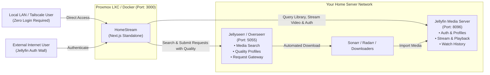

# 🍿 HomeStream

> **A modern, responsive web companion and streaming frontend built specifically for your self-hosted media stack.**  
> Seamlessly interfaces with **Jellyfin** for local media streaming and **Seerr** (Jellyseerr / Overseerr) for catalog searching and 1-click automated requests. Easily deployed via **Proxmox VE LXC** or **Docker**.

---

## ⚖️ Disclaimer

**HomeStream** is an independent, open-source, non-commercial companion client designed solely to interface with personal, self-hosted media server stacks (such as Jellyfin and Jellyseerr/Overseerr).

This project is **not** affiliated with, endorsed by, sponsored by, or associated in any way with Netflix, Inc. or any commercial streaming service provider. All product names, logos, and brands are property of their respective trademark owners. Use of these names, logos, and brands does not imply endorsement or affiliation.

---

## ✨ Features

- **🎬 Modern Cinematic Streaming Experience**:
  - Dark cinematic aesthetic (`#141414`), sleek red accents, and smooth typography.
  - Dynamic **Hero Billboard** featuring featured backdrop, match rating, resolution & audio badges, synopsis, "Play" and "More Info" buttons.
  - Multi-item dynamic billboard that auto-rotates through featured items with manual carousel controls.
  - Horizontal scrolling carousels with smooth navigation and card hover zoom previews.
  - Hover previews seek automatically to random points (15%–75% runtime) with teaser loop and audio toggle.
  - **Top 10 Today** row with massive stylized rank numerals (1–10).
  - **Continue Watching** row with user resume progress bars and direct resume click.
  - Category and genre rows (Recently Added Movies, Recently Added Series, Trending) strictly partitioned by media type.

- **👤 Decoupled Profiles & First-Run Setup**:
  - Profiles are decoupled from Jellyfin: choose which Jellyfin profiles to import on first run rather than automatically importing all users.
  - Create new profiles directly in HomeStream; if a profile doesn't exist in Jellyfin, it is created automatically so resume progress and watch tracking stay synchronized.
  - Profile switcher ("Who's watching?") with custom avatar gradients and initials.

- **🔒 Smart Network Authentication (LAN / Tailscale vs. External Internet)**:
  - **Zero-Friction Local & Tailscale**: Users connecting from local subnets (`192.168.0.0/16`, `10.0.0.0/8`, `172.16.0.0/12`, `127.0.0.1`) or over **Tailscale** (`100.64.0.0/10` CGNAT range, `fd7a:115c:a1e0::/48`, or `*.ts.net` domains) bypass authentication completely for immediate access.
  - **Secure External Internet Gate**: Connections from the public internet (without Tailscale) encounter a login screen requiring Jellyfin credentials (`/Users/AuthenticateByName`).
  - **External Profile Locking**: External sessions are locked strictly to the authenticated Jellyfin user with profile switching disabled, preventing unauthorized access to other profiles over the public internet.

- **📊 Accurate Technical Media & Audio Quality Badges**:
  - Real-time video stream inspection: displays true resolution badges (`4K UHD`, `1080p HD`, `720p HD`, `SD`) and HDR/Dolby Vision flags based on actual stream dimensions and metadata.
  - True audio format detection: identifies `Dolby Atmos`, `7.1 Surround`, `5.1 Surround`, `Stereo`, and `Mono` directly from the media streams.
  - Prospective Seerr items omit technical badges until downloaded and analyzed by your media server.

- **🎯 Comprehensive "Request Content" Portal**:
  - **Recommended for You**: High-accuracy recommendations calculated dynamically from your profile's watch history and top genres in Jellyfin.
  - **Popular Titles**: Trending media across both movies and TV shows from Seerr.
  - **Top Movies & Top TV Shows**: Dedicated discovery carousels.
  - **Dynamic Quality Profile Selection**: The request dialog pulls live quality profiles directly from Radarr / Sonarr via Seerr (e.g. `HD - 720p/1080p`, `Ultra-HD 4K`), allowing you to select your preferred quality tier when requesting media.
  - Rotating Hero Banner on the request page cycling through recommended titles with a 1-click **Request Download** button.

- **🎞️ Universal Video Previews & Edge-Safe Alignment**:
  - Intelligent edge-aware positioning prevents hover cards from getting clipped at viewport edges.
  - Transparent on-the-fly transcoding for non-native video formats (`.avi`, `.mkv`, MPEG-4 formats) into H.264/AAC MP4.
  - Native MP4 playback with byte-range support for seamless seeking (including YouTube library content).

- **📺 Dual-Mode Web Video Player & Native Jellyfin Embed**:
  - Fullscreen video playback with custom scrubber timeline, buffer bar, 10-second skip forward/back, and volume control.
  - Streams directly from Jellyfin (`/Videos/{itemId}/stream`) or embeds Jellyfin's native web player in 1 click.
  - Episode drawer for TV shows to jump between episodes or auto-play next episode.
  - Reports playback progress to Jellyfin so watch history stays synchronized across all client devices.

- **🌐 SEO & Deep Linking**:
  - Complete `sitemap.xml` and `robots.txt` endpoints indexing available media.
  - Deep-linkable shareable URLs (`/?tab=movies`, `/?tab=series`, `/?tab=requests`, `/?media=<id>`, `/?watch=<id>`).
  - Social OpenGraph cards generated dynamically (`/opengraph-image`).

- **📦 Proxmox VE LXC & Docker Ready**:
  - Standalone multi-stage lightweight Docker image (`<120MB`).
  - Automated 1-line Proxmox VE LXC installer script.
  - Clean `docker-compose.yml` with port 3000 and environment variable configuration.

---

## 🏗️ Architecture



---

## 🚀 Proxmox LXC Deployment

### Option 1: Proxmox VE Helper Script (community-scripts.org format)

Run this command directly in your **Proxmox VE Host Shell** (`pve` node):

```bash
bash -c "$(curl -fsSL https://raw.githubusercontent.com/Eckobrew/HomeStream/main/ct/homestream.sh)"
```

Built following the official **[community-scripts.org](https://community-scripts.org)** architecture:
1. Presents the standard Default Settings vs. Advanced Settings dialog.
2. Creates an optimized Debian 12 LXC container with 2 vCPUs, 2GB RAM, and 8GB storage.
3. Configures Node.js 20, builds HomeStream, and enables the systemd service.
4. Provides native container management via the `update` command inside the container.
5. Outputs your access URL: `http://<LXC_IP>:3000`.

---

### Option 2: Docker Compose (Existing LXC or VM)

If you already have a Linux machine, VM, or LXC with Docker:

1. Clone this repository:
   ```bash
   git clone https://github.com/Eckobrew/HomeStream.git /opt/homestream
   cd /opt/homestream
   ```

2. Copy the environment configuration:
   ```bash
   cp .env.example .env
   nano .env
   ```

3. Launch HomeStream:
   ```bash
   docker compose up -d
   ```

4. Open `http://<YOUR_IP>:3000` in your web browser.

---

## 🔧 Configuration & Environment Variables

You can configure HomeStream via environment variables (`.env`) or inside the web interface by clicking **Server Settings** in the profile menu.

| Variable | Default | Description |
|---|---|---|
| `APP_NAME` | `HomeStream` | Application display name. |
| `NEXT_PUBLIC_APP_NAME` | `HomeStream` | Client-side brand name shown in UI, navbar, and headers. |
| `PORT` | `3000` | Port for the web interface. |
| `JELLYFIN_URL` | - | URL to your Jellyfin server (e.g. `http://192.168.1.50:8096` or `https://jellyfin.domain.com`). |
| `JELLYFIN_API_KEY` | - | Jellyfin API Key (Dashboard -> Advanced -> API Keys -> "+"). |
| `JELLYFIN_USER_ID` | *(Optional)* | Default Jellyfin user ID for initial seeding. |
| `SEERR_URL` | - | URL to Jellyseerr or Overseerr (e.g. `http://192.168.1.50:5055` or `https://seerr.domain.com`). |
| `SEERR_API_KEY` | - | Seerr API Key (Settings -> General -> API Key). |
| `DATA_DIR` | `/app/data` | Persistent data directory for storing decoupled `profiles.json`. |

### 1. Jellyfin API Key Setup
1. Open Jellyfin Web Client -> **Dashboard** (Admin).
2. Navigate to **Advanced** -> **API Keys**.
3. Click **+** (Add) and name it `HomeStream`.
4. Copy and paste the generated API Key into your `.env` or Server Settings dialog.

### 2. Seerr (Jellyseerr / Overseerr) API Key Setup
1. Open Jellyseerr/Overseerr -> **Settings**.
2. Click **General** in the left sidebar.
3. Copy your **API Key** from the top card.

---

## 🎬 How It Works

### Browsing & Home Screen
When you visit HomeStream:
- If connecting locally or over Tailscale, you immediately see the home screen with full profile switching.
- If connecting from the public internet, you are presented with a Jellyfin login screen and your session is locked to your account.
- HomeStream queries Jellyfin for:
  - Current user's **Continue Watching** (`/UserItems/Resume`)
  - **Recently Added Movies** and **Recently Added TV Shows**
  - **Top Rated** (for the Top 10 carousel)

### Searching & Downloading via Seerr
1. Typing in the search bar queries Seerr's unified database (TMDB movies and TV series).
2. Results are cross-checked with your local Jellyfin library:
   - 🟢 **Available on Jellyfin**: Stream directly.
   - 🟡 **Requested**: In queue / downloading via Sonarr or Radarr.
   - 🔵 **Request**: Opens the download dialog.
3. The request dialog fetches live quality profiles from Radarr / Sonarr, letting you choose the target quality (e.g. `HD - 720p/1080p` or `Ultra-HD 4K`) and select specific seasons.

### Built-in Video Playback
When you click **Play**:
- The custom HomeStream video player launches fullscreen with resume tracking.
- Plays direct streams or adaptive HLS from Jellyfin.
- Seamlessly toggle between the **Built-in Player** and the **Jellyfin Embedded Web Player** at any time.

---

## 🛠️ Local Development

```bash
# 1. Install dependencies
npm install

# 2. Run local dev server
npm run dev

# 3. Open browser
open http://localhost:3000
```

---

## 📄 License
MIT License. Built for the self-hosting community.

## Native Android and Android TV client API

The native client is an independent Android project. This repository supplies
the optional `/api/mobile/v1` API it consumes. Set `HOMESTREAM_MOBILE_TOKEN` to a
random secret of at least 32 characters (`openssl rand -hex 32`), restart
HomeStream, then pair the Android app with the server URL and that token.
Docker Compose passes the token from `.env` into the container. The API remains
disabled when the token is absent.

See [the mobile API contract](docs/mobile-api.md) for endpoints, household access
semantics, and Chromecast/Jellyfin network requirements. Run `npm run test:mobile`
for isolated API integration checks. No Android source or Android build tools
are required to run this server.

## Audit and client integration update

See [audit fixes and migration notes](docs/audit-fixes.md) before deploying the
Android 1.1.0 integration and updated authentication. This includes signed
sessions, explicit proxy trust, episode queues and watched-state APIs.
